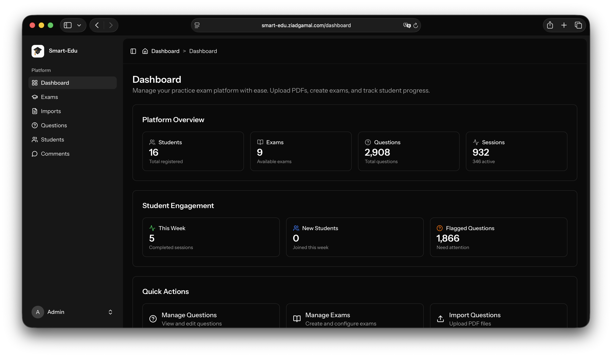
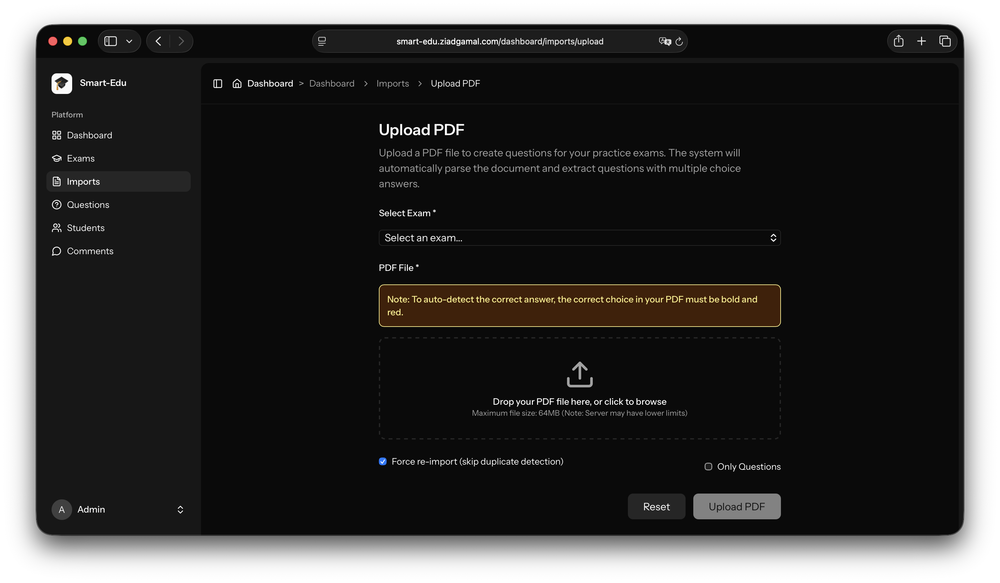
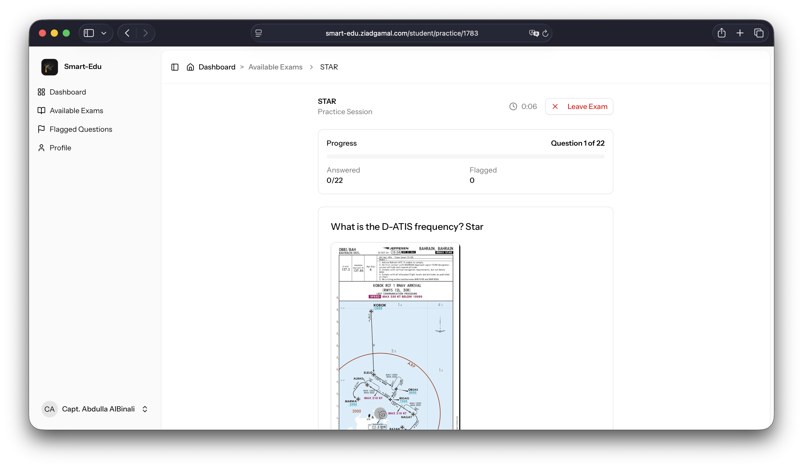
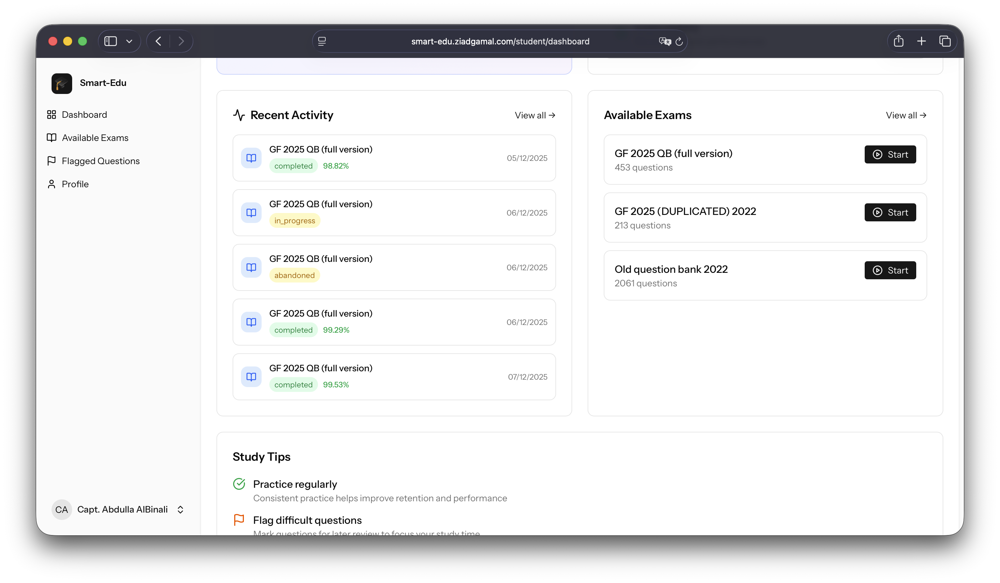
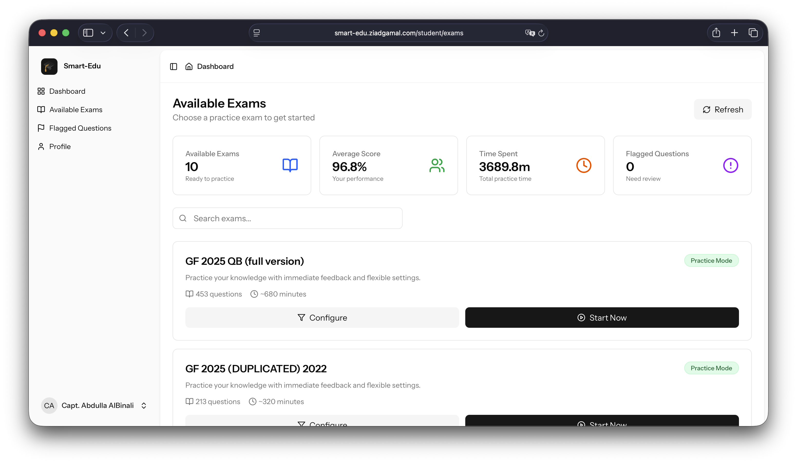
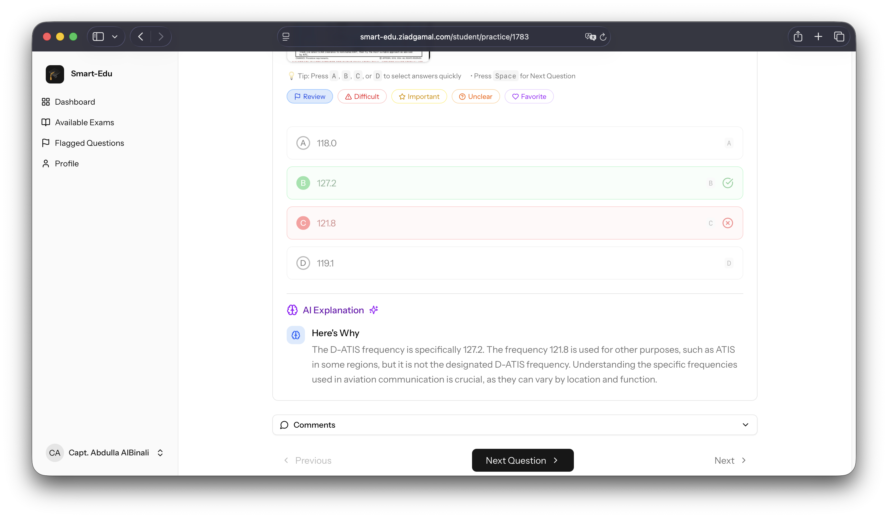

# Smart-Edu: Intelligent Exam Platform

**Live Demo:** [https://smart-edu.ziadgamal.com](https://smart-edu.ziadgamal.com)

Aviation exam-prep platform. A deterministic PDF parser turns question-bank PDFs into practice exams: 99.61% extraction rate (2,055 of 2,063 questions on one real question bank).

---

## Overview

Smart-Edu addresses a critical bottleneck in the e-learning industry: manual data entry. Educational institutions spend countless hours digitizing legacy exams. This platform automates the import with a deterministic Python parser (PyMuPDF plus pattern matching) behind a queued job. AI is a fallback layer, not the extraction engine.

**Key result:** 2,055 of 2,063 questions extracted (99.61% extraction rate) from one real question-bank PDF. This figure comes from the deterministic parser; AI only fills a missing answer key and rescues questions the parser could not read.

## Key Features

### Intelligent PDF Extraction
*   **Extraction rate:** 99.61% (2,055 of 2,063) on a multi-column question bank, from the deterministic pipeline.
*   **Structure Recognition:** Automatically identifies questions, choices (A-D), and correct answers.
*   **Media Handling:** Preserves mathematical formulas and diagrams.
*   **Quality Control:** Automated flags for low-confidence extractions requiring human review.

### Student Experience
*   **Real-time Exam Player:** A distraction-free environment for taking practice tests.
*   **Instant Feedback:** Immediate grading with detailed performance breakdowns.
*   **AI Tutoring:** Integrated AI provides context-aware explanations for incorrect answers, acting as a personal tutor.
*   **Multi-Theme Support:** Optimized for readability in both Light and Dark modes.

## Technology Stack

*   **Backend:** Laravel 12, PHP 8.3
*   **Frontend:** React 19, Inertia.js, TypeScript
*   **Infrastructure:** Nginx, Supervisor (database queue workers), Laravel Reverb (WebSockets), MySQL
*   **Processing:** Python, PyMuPDF
*   **AI (fallback and student feedback):** OpenAI API with Gemini fallback

## Architecture & Documentation

For a deep dive into the system's engineering, please refer to the documentation in the `docs/` directory:

*   **[Technical Project Overview](docs/PROJECT.md)**: Detailed feature breakdown and impact analysis.
*   **[System Architecture](docs/ARCHITECTURE.md)**: Diagrams and explanation of the hybrid PHP/Python pipeline and real-time event system.

## License

MIT License. See LICENSE file for details.

---

**Status:** Delivered (client project)
**Contact:** [ziadgamal.com](https://ziadgamal.com)
